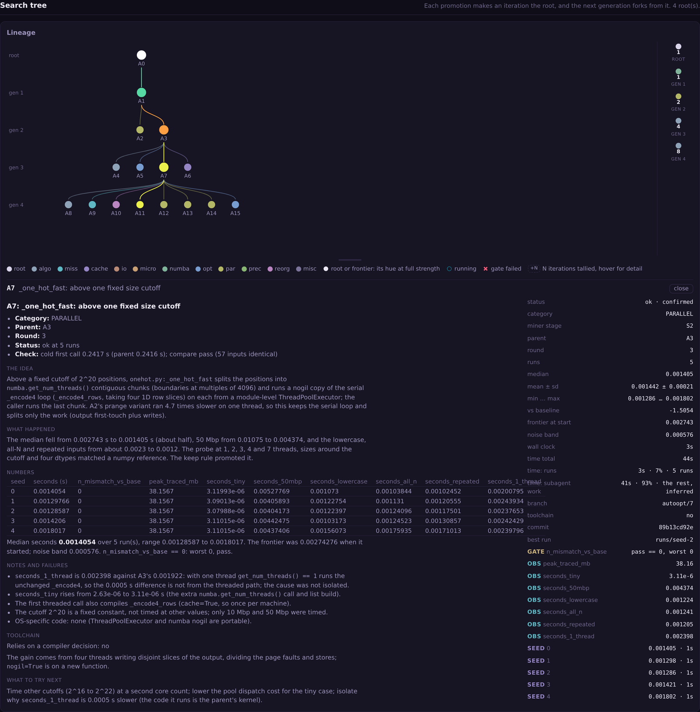

# auto-optimize

Historically, the task of improving software has been performed by humans who knew
too much about how computers worked. As punishment for learning too much about how 
computers worked, the computers punished us by becoming better than us at this task.

Auto-optimization is the process by which agents iteratively find improvements
to a codebase which optimize a given performance measure (or set of such measures).
This repository is a Claude Code skill that implements auto-optimization with all
the quality-of-life features I always wished I had in the past, including:

- an interview at the beginning
- separation of "runs" from "iterations", where each "iteration" is an idea and multiple "runs" can be done to establish performance distributions
- external validations that can be run once per iteration, such as a unit test suite or a complete processing step, to ensure no drift
- observational measures that are also recorded each iteration but not used to decide (e.g., memory usage, first run compile time)
- a pretty interactive dashboard to monitor progress
- clean logging, formatting, usage of git worktrees, and documentation at each step, with instructions for future agents to build on top of what I have built here
- clean division of work done by subagents and work done by deterministic scripts, to give consistent and robust results

Conceptually, there are many things that one may wish to auto-optimize. Each thing
is shaped slightly differently, and so our approach will be to release skills for
each kind of thing one can auto-optimize that perfectly fits that setting.

(1) auto-optimize-code: the focus of this skill is optimizing the runtime and memory
usage of code while keeping identical outputs. Hence, things like unit tests, running
small real examples at each iteration, and comparison of outputs at the byte-level
are relevant. This can be run on functions in a code-base, command-line tools, or
entire end-to-end algorithms or multi-step procedures.

(More to come.)

Developed at the [Programmable Genomics Laboratory](https://programmable-genomics.github.io) @ UMass Chan Medical School.

## Requirements

- Claude Code. The skill spawns subagents and asks you questions, so it needs
  Claude Code's Agent and AskUserQuestion tools.
- Linux, Python 3.9 or later as `python3`, git and tar. The skill's scripts use
  only the standard library.
- For the dashboard in a notebook: JupyterLab, IPython and plotly; psutil for
  the host and process panels.
- For a benchmark that uses GPUs: `CUDA_VISIBLE_DEVICES` set by the machine's
  GPU allocator, which the interview asks about.

`auto-optimize doctor` checks these once the installer is available (below).

## Install

The skill is one folder, `skills/auto-optimize-code/`. Each method below puts
that folder where Claude Code looks for skills; use one of them.

**As a Claude Code plugin.** In Claude Code:

```
/plugin install auto-optimize --marketplace jmschrei/auto-optimize
```

or, in two steps, `/plugin marketplace add jmschrei/auto-optimize` and then
`/plugin install auto-optimize@auto-optimize`. From a shell, `claude plugin
marketplace add jmschrei/auto-optimize` and then `claude plugin install
auto-optimize@auto-optimize`. The skill shows as
`auto-optimize:auto-optimize-code`. Update it with `claude plugin update
auto-optimize@auto-optimize`.

**With the installer, no clone.** With [uv](https://docs.astral.sh/uv/):

```bash
uvx auto-optimize install              # into ~/.claude/skills/, for every project
uvx auto-optimize install --project    # into ./.claude/skills/, for this project only
```

or `pipx run auto-optimize install`, or `pip install auto-optimize` and then
`auto-optimize install`. Run `install` again with a newer version to update.
The installer writes nothing until you run `install`, and replaces only a
copy it made itself; `--force` replaces anything else at that path.

| Command | Does |
|---|---|
| `auto-optimize install [--project [DIR] \| -d DIR] [--symlink] [-f]` | copy (or link) the skill into a skills folder |
| `auto-optimize uninstall [--project [DIR] \| -d DIR] [-f]` | remove a copy the installer made |
| `auto-optimize list` | every copy Claude Code would load from here: user, project and plugin |
| `auto-optimize path` | the installed skill's folder |
| `auto-optimize doctor` | check Linux, `python3`, git, tar, the dashboard's modules and the installed copies |

When `CLAUDE_CONFIG_DIR` is set, the installer uses its `skills/` folder in
place of `~/.claude/skills/`.

**From a clone, linked.** Edits in the clone and `git pull` reach Claude Code
at once:

```bash
git clone https://github.com/jmschrei/auto-optimize
cd auto-optimize
uv run auto-optimize install --symlink      # or: ln -s "$PWD/skills/auto-optimize-code" ~/.claude/skills/
```

**By hand.** Copy `skills/auto-optimize-code/` into any skills folder. It is
self-contained and carries its own `LICENSE`.

Install it one way only: Claude Code loads every copy it finds, and two copies
of one skill compete for the same requests. `auto-optimize list` shows them.

## A first search

Ask in Claude Code, in plain words:

> Optimize `count_kmers` in `kmers.py` for speed. The output must stay
> identical.

The skill starts with an interview: what number to improve and in which
direction, what must not change and how strictly (bitwise, a tolerance, a
correlation), what to record without optimizing, how many runs per
iteration, the GPUs, which model runs the iteration subagents, the budget,
and where the search lives. The default is
`~/auto-optimize/<YYYY-MM-DD>-<name>/`, which needs room for a copy of the
code per iteration. Then, without you:

1. a setup subagent writes the benchmark, checks that its seed controls what
   it should, proves that each gate catches a planted fault, measures the
   noise and runs the baseline, A0;
2. an idea miner reads A0's profile and lists ideas by category;
3. iteration subagents each take one idea, implement it in a fresh worktree
   forked from the root (the last change kept), measure it and write a
   README; a change that passes the keep rule becomes the next root;
4. the search ends on your word or at the budget you set: the winner is timed
   against A0 in paired runs and summarized in `ended.md`;
5. the winner is copied out with a final report, and the disk is reclaimed
   once you agree.

`examples/one-hot/` is a slow, correct one-hot encoder to try this on;
the walkthrough below is a search on it.

**What it costs.** Every iteration is a subagent session, and so is each
setup, mining and orchestration phase, so a search of a few dozen iterations
runs that many agent sessions. `autoopt.py tokens <work>` adds up what a
search's agents spent, from Claude Code's transcripts; the walkthrough's
numbers are at its end.

## Walkthrough: a one-hot encoder, 1,070 times faster

A real search with this skill on a shared 256-core Linux server. The numbers,
the dashboard and the code below come from that run; the home directory is
written as `~`, and the dashboard's host and GPU strip is left out of the
pictures.

**The code.** `examples/one-hot/onehot.py` is correct and slow: two nested
loops test each position against each letter.

```python
def one_hot_encode(sequence, alphabet='ACGT', dtype=numpy.int8):
	ohe = numpy.zeros((len(alphabet), len(sequence)), dtype=dtype)

	for i, character in enumerate(sequence):
		for j, letter in enumerate(alphabet):
			if character == letter:
				ohe[j, i] = 1

	return ohe
```

**The prompt**, in Claude Code, from that folder:


**The interview.** Three rounds of questions pinned the search down. Every
answer, and each default taken without asking, went into the search's
`spec.md`, which every subagent reads.

| Question | Answer |
|---|---|
| Where the search lives | `~/auto-optimization/2026-11-21-one-hot/` |
| Objective | seconds per call, lower is better |
| Benchmark input | one 10 Mbp sequence, about 1% N and 1% lowercase bases |
| What must not change | the output, bitwise: values, dtype and shape |
| Runs per iteration | 5 |
| Dependencies | numba may be added; the signature and behavior stay |
| Tracked, not gated | 1 bp, 50 Mbp, all lowercase, all N and one repeated base |
| Threads in the timed call | up to 4 |
| Iteration subagents | sonnet |
| Budget | 15 iterations |

**Setup.** A setup subagent wrote the benchmark and proved the gate before
measuring anything: unchanged code and a loop-order swap gave 0 mismatches,
and a case-insensitive version gave 100,300 and failed. It checked that the
seed changes the input but not the timing, and that two runs at once do not
disturb each other. It stopped once to ask whether to run beside another job
on the machine (the answer was yes). The baseline, A0: a median of 1.507 s
over 5 runs.

**The search.** An idea miner read A0's profile, which put the whole call in
`one_hot_encode`, and wrote seven ideas. An orchestrator subagent handed them
to iteration subagents one at a time. The first, A1, replaced the loops with
a numba kernel and took the call from 1.507 s to 3.5 ms. A change of more
than tenfold stops the orchestrator: one 3.5 ms call is noisy (A1's runs
spanned 3.1 to 4.5 ms), so it asked whether to go on, start a new search
whose benchmark repeats the call, or stop. Nobody answered within ten
minutes, so the main session took the answer that does the least damage if
wrong, going on, and wrote it down in `ideas.md`. Four more idea-miner
stages refilled the ideas as they ran out.

The dashboard in JupyterLab, after the search ended:


The objective by iteration, on a log axis. Each point is one iteration's
median over its 5 runs, colored by the kind of idea; the dotted pink
staircase is the best so far, and the dashed purple lines mark each new batch
of ideas:


Three changes were kept, each forking the next generation: A1, the numba
kernel; A3, which reads an ASCII string's own buffer in place of an `encode`
copy (2.74 ms, and 9.5 MB less peak memory); and A7, which runs the kernel on
4 threads over contiguous chunks above 2^20 positions (1.405 ms). The
dashboard's frontier names A11 (1.343 ms), the best median measured: its gain
over A7 was inside the noise band, so the keep rule did not take it, and A7
is the winner.

**Clicking an iteration.** A click on A1's point on the chart opens its code
change against its parent: the loops became a kernel over the sequence's
bytes, with the original loop kept for the inputs the kernel does not handle.


A click on A7 in the search tree opens its README: the idea, what happened,
every run, and its notes, which say that the one-thread time rose by 0.5 ms
and that the cause was not found.



**The end.** At the 15-iteration budget, `end` timed A7 against A0 in
alternating separate processes and wrote `ended.md`:

```
- Objective `seconds` (min): the median goes from 1.507 in A0 to 0.001405 in A7: 1.507 -> 0.001405 s (-1.505, -99.9%).
- Gates, worst run of A7: `n_mismatch_vs_base == 0`: pass (0).
- Paired, on the search's own input: A7 vs A0, B better, -1.5, 9/9, p = 0.0039; at 4 threads, B better, -1.5, 9/9, p = 0.0039.
```

The read-only commands answer questions about it afterwards:

```
$ python3 $AO/autoopt.py table ~/auto-optimization/2026-11-21-one-hot --status ok --sort best --limit 5 \
	--fields id,category,title,median,vs_base_pct,keep
id   category      title                                     median    vs_base_pct  keep
---  ------------  ----------------------------------------  --------  -----------  ----
A11  PARALLEL      _encode4_threaded: replace the ThreadPoo  0.001343  -99.91       fail
A7   PARALLEL      _one_hot_fast: above one fixed size cuto  0.001405  -99.91       pass
A9   CACHE_MISS    _encode4: change the loop order from one  0.001406  -99.91       fail
A15  OPTIMIZATION  _one_hot_fast: on Linux only              0.001455  -99.9        fail
A14  PARALLEL      _encode4_threaded: when the output dtype  0.001468  -99.9        fail

$ python3 $AO/autoopt.py show ~/auto-optimization/2026-11-21-one-hot A7     # an excerpt
A7  _one_hot_fast: above one fixed size cutoff
category   PARALLEL, round 3, parent A3, branch autoopt/7, commit 89b13cd92e90
status     ok at 5 runs
median     0.0014054 s (std 0.00021, range 0.00128587 to 0.0018017, 5 runs)
vs parent  -0.001337 (-48.8%) against A3's 0.00274276
vs A0      -1.505 (-99.9%) against A0's 1.50683
keep       pass: its median beats its parent's by 0.001337 > the noise band 0.000576
gate       n_mismatch_vs_base == 0: pass (worst 0)
check      cold first call 0.2417 s (parent 0.2416 s); compare pass (57 inputs identical)
change     1 file changed, 51 insertions(+), 1 deletion(-); git -C … diff autoopt/3...autoopt/7
…
```

The 12 iterations that were not kept all passed the gate; they were slower
or inside the noise band. Among them: numba's `prange` over the kernel's
loop (A2, slower than the serial kernel), two numpy-only versions (3.6 and
2.1 times slower than the kernel they were measured against), and a
huge-page-aligned output. The observers recorded what the
winner costs elsewhere: a cold first call of 0.24 s for numba's compile
(once per machine, since the kernels are cached), and a 1 bp input at
3.1 µs where the loop took 0.43 µs.

**What it took.** 15 iterations and the baseline, 80 runs and 217 s of
benchmark time. The wall clock was 2 h 9 min, about 30 minutes of it
waiting on questions nobody was there to answer. By `autoopt.py tokens`,
25 agent sessions spent 9.5 million weighted tokens (cache reads weigh 0.05,
output 5); each iteration subagent averaged 131 thousand.

## Watching it

The skill starts the dashboard with the first iteration and tells you where
it is: `<work>/dashboard.ipynb`, a live page in JupyterLab with the objective
by iteration, the frontier, the search tree, every run, the GPUs, the running
processes, and each iteration's code change against its parent. At the end it
writes a self-contained snapshot, `<work>/autooptimize/final/dashboard.html`,
which opens in any browser.

## Reading the results

Ask Claude ("what did the search find?", "what did A7 try?"); the skill
answers from read-only commands. Or run them yourself:

```bash
AO="$(auto-optimize path)/scripts"     # or the skills folder you installed into
python3 $AO/autoopt.py status <work> --brief                 # where it stands
python3 $AO/autoopt.py table <work> --status ok --sort best  # every passing iteration, best first
python3 $AO/autoopt.py show <work> A7                        # one iteration: numbers, verdict, change, notes
python3 $AO/autoopt.py path <work> --markdown                # the kept changes from A0 to the winner
```

`<work>/autooptimize/ended.md` summarizes an ended search, and
`<work>/finish/final-report.md` is the final report. `table --json` and
`show --json` print raw values for a program; the record files are described
in `skills/auto-optimize-code/references/layout.md`.

## How it works

`skills/auto-optimize-code/SKILL.md` is what Claude reads. It defines the
words (a **run** is one seed, an **iteration** one idea measured over several
runs, a **round** the iterations forked from one root), the rules that hold
throughout, and routes each step to a file in `references/`. The scripts in
`scripts/` keep every number: `run_iteration.py` measures an iteration and
judges it against its gates and the noise band, and `autoopt.py` keeps the
search tree, the briefs, the promotions and the records. Only a median the
runner computed counts as a result; no agent types a number in.

## When it is the wrong tool

- One measurement, not a search: timing a function once needs a benchmark
  alone.
- No measurable objective: if no script can emit it as a number, that comes
  first.
- Improving a model's accuracy or training recipe: this skill optimizes code,
  with its outputs gated.

## Repository layout

```
.claude-plugin/          the plugin manifest and its one-plugin marketplace
skills/
  auto-optimize-code/    the skill: SKILL.md, references/, scripts/, LICENSE, VERSION
src/auto_optimize/       the installer (standard library only)
tests/
  code/                  the skill's script suites; dashboard/ holds the browser tests
  package/               the installer and the shipped files (pytest)
examples/one-hot/        the slow function the walkthrough optimizes
docs/walkthrough/        the walkthrough's screenshots
```

## Development

```bash
python3 tests/code/run_tests.py                  # every script suite, one line each (a few minutes)
python3 tests/code/run_tests.py test_reading     # one suite
uv run pytest                                    # the installer and the shipped files
python3 tests/code/dashboard/test_frontend.py    # the dashboard in headless Chromium (needs playwright)
python3 tests/code/dashboard/test_notebook.py    # the dashboard mounted in JupyterLab
```

`tests/code/dashboard/README.md` describes the dashboard's suites. The
version is `__version__` in `src/auto_optimize/__init__.py`; the skill's
`VERSION` file and both plugin manifests carry the same number, which
`tests/package/test_skill_files.py` checks.

## License

MIT (`LICENSE`).
