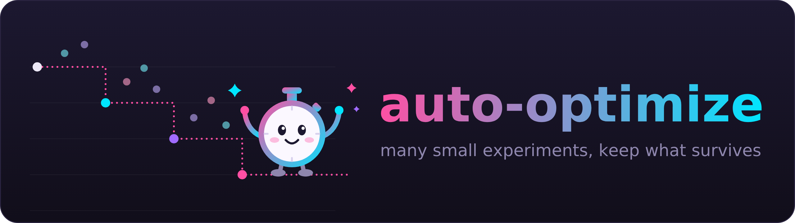
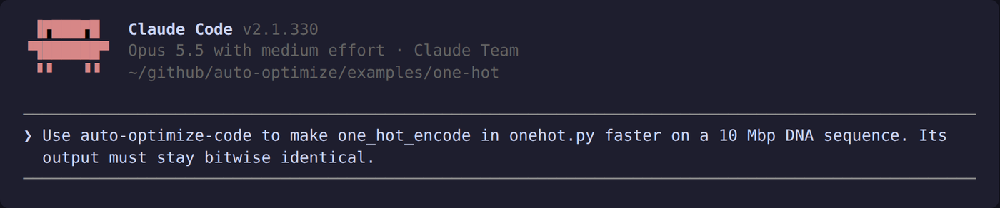
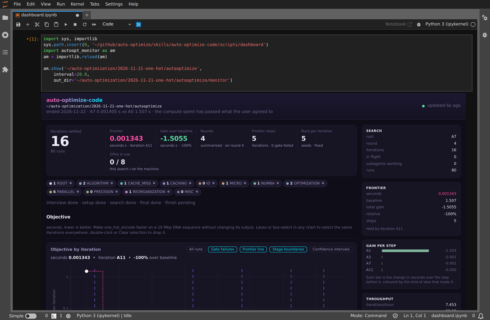
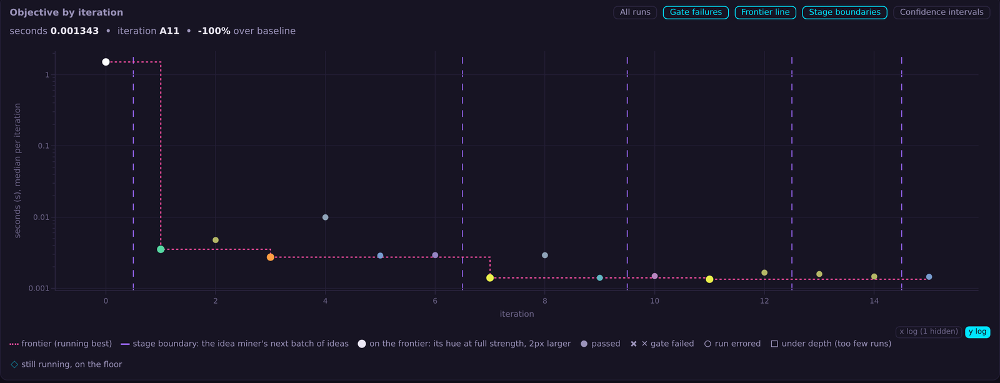
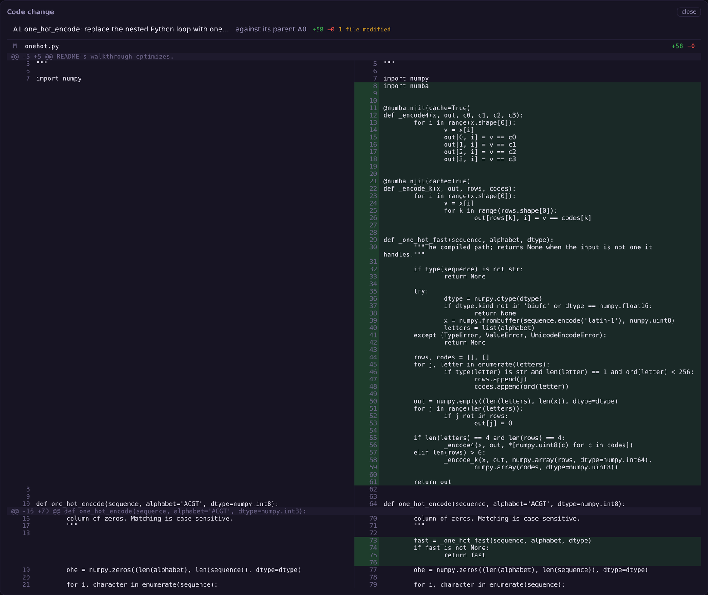

<h1 align="center"></h1>

[](https://github.com/jmschrei/auto-optimize/actions/workflows/ci.yml)
[](LICENSE)

[[Example Dashboard](https://claude.ai/artifact/724GcNKDAktnrgNkGxwh2f)] [[Glossay-Annotated Dashboard](https://claude.ai/artifact/S1nrSF1CSE3KLpZBEDxomB)]

Historically, the task of improving software has been performed by humans who knew
too much about how computers worked. As punishment for learning too much about how 
computers worked, the computers become better than us at this task (and soon 
everything).

Auto-optimization is the process by which agents iteratively find improvements
to a codebase which optimize a given performance measure (or set of such measures).
Almost all agentic systems can perform the core mechanics of auto-optimization via 
simple looping without the need for a skill, but the details of the process and
logging will change run-to-run. This repository implements auto-optimization with
all of the quality-of-life features I always wished I had in the past to force
more robust statistics, deterministic behavior, logging of each step, and pretty
dashboards.

Conceptually, there are many things you may wish to auto-optimize, with performance
of a machine learning model being the most popular. Each thing has a slightly
different shape and so will have a separate skill. Currently, this repository only
ships with `auto-optimize-code`, which focuses on optimizing the speed and memory
usage of code (including model inference!) subject to identical outputs or other
reasonable relaxed gates. As a random note, I have found that Sonnet 5.5 is very
good at this task and produced better outputs much faster than Opus 5.5 with xhigh
thinking. This may depend on your setup though. More will be coming soon!

An interesting thing about optimizing code speed in this way is that *overfitting
is good!* Now, instead of having to produce a general-purpose implementation that
works for everyone, regardless of compiler and hardware (including GPU), you can
fit the software to your specific device. As long as the outputs are identical,
using a different set of CUDA kernels or in-lined sets of functions is no
problem.

This skill comes with hooks and comprehensive logging to enable you to extend it
however you would like, including building an entirely new dashboard, integrating
it with your code, adding in custom steps wherever you would like, and much more.

You are free to use the outputs of this process however you would like, including
for commercial use, without requirements for attribution. However, finding a way 
to support our work, even in small ways such as shout-outs, is always appreciated 
so we can continue to do this in the future.

Developed at the [Programmable Genomics Laboratory](https://programmable-genomics.github.io) @ UMass Chan Medical School.

## Requirements

- Claude Code. The skill spawns subagents and asks you questions, so it needs
  Claude Code's Agent and AskUserQuestion tools; the orchestrator, itself a
  subagent, spawns the iteration subagents.
- Linux, Python 3.9 or later as `python3`, git and tar. The skill's scripts use
  only the standard library.
- For the dashboard in a notebook: JupyterLab, IPython and plotly; psutil for
  the host and process panels.
- For a benchmark that uses GPUs: `CUDA_VISIBLE_DEVICES` set by the machine's
  GPU allocator, which the interview asks about.

`auto-optimize doctor` checks these once the installer is available (below).

## Install

The skill is one folder, `skills/auto-optimize-code/`. Each method below puts
that folder where Claude Code looks for skills; use one of them.

**As a Claude Code plugin.** In Claude Code:

```
/plugin install auto-optimize --marketplace jmschrei/auto-optimize
```

or, in two steps, `/plugin marketplace add jmschrei/auto-optimize` and then
`/plugin install auto-optimize@auto-optimize`. From a shell, `claude plugin
marketplace add jmschrei/auto-optimize` and then `claude plugin install
auto-optimize@auto-optimize`. The skill shows as
`auto-optimize:auto-optimize-code`. Update it with `claude plugin update
auto-optimize@auto-optimize`.

**With the installer, no clone.** With [uv](https://docs.astral.sh/uv/):

```bash
uvx auto-optimize install              # into ~/.claude/skills/, for every project
uvx auto-optimize install --project    # into ./.claude/skills/, for this project only
```

or `pipx run auto-optimize install`, or `pip install auto-optimize` and then
`auto-optimize install`. Run `install` again with a newer version to update.
The installer writes nothing until you run `install`, and replaces only a
copy it made itself; `--force` replaces anything else at that path.

| Command | Does |
|---|---|
| `auto-optimize install [--project [DIR] \| -d DIR] [--symlink] [-f]` | copy (or link) the skill into a skills folder |
| `auto-optimize uninstall [--project [DIR] \| -d DIR] [-f]` | remove a copy the installer made |
| `auto-optimize list` | every copy Claude Code would load from here: user, project and plugin, and a clone of this repository from before 1.0.0, which competes with the skill |
| `auto-optimize path` | the installed skill's folder |
| `auto-optimize doctor` | check Linux, `python3`, git, tar, the dashboard's modules and the installed copies |

When `CLAUDE_CONFIG_DIR` is set, the installer uses its `skills/` folder in
place of `~/.claude/skills/`.

**From a clone, linked.** Edits in the clone and `git pull` reach Claude Code
at once:

```bash
git clone https://github.com/jmschrei/auto-optimize
cd auto-optimize
uv run auto-optimize install --symlink      # or: ln -s "$PWD/skills/auto-optimize-code" ~/.claude/skills/
```

**By hand.** Copy `skills/auto-optimize-code/` into any skills folder. It is
self-contained and carries its own `LICENSE`.

Install it one way only: Claude Code loads every copy it finds, and two copies
of one skill compete for the same requests. `auto-optimize list` shows them.

## A first search

auto-optimize is build for two main use-cases: your code is in a Git
repository that can accept pull requests, or it is just a stand-alone
piece of code. In each case, the overall process is the same: write a
prompt along the lines of "auto-optimize <this function or pipeline>",
answer a series of interview questions, let the search run, and then ship
the results. If you are working on a Git repository, shipping the results
means opening a PR (or two PRs if you also had it write unit tests) as
well as a bug report issue with everything that it found along the way.
If you are working with an individual script, shipping means just applying
the changes to a new copy of the code.

The quickest test is the example in this repository, a correct and slow
one-hot encoder:

```bash
git clone https://github.com/jmschrei/auto-optimize
cd auto-optimize/examples/one-hot
python3 -m pip install numpy      # the example's dependency; add numba if the search may use it
python3 onehot.py                 # prints a small encoding: the code runs
claude
```

Then ask:

> Use auto-optimize-code to make one_hot_encode in onehot.py faster on a 10
> Mbp DNA sequence. Its output must stay bitwise identical.

On your own code, ask in plain words: "Optimize `count_kmers` in `kmers.py`
for speed. The output must stay identical."

The skill starts with an interview: what number to improve and in which
direction, what must not change and how strictly (bitwise, a tolerance, a
correlation), what to record without optimizing, how many runs per
iteration, the GPUs, which model runs the iteration subagents, the budget,
and where the search lives. The default is
`~/auto-optimize/<YYYY-MM-DD>-<name>/`, which needs room for a copy of the
code per iteration. Then, without you:

1. a setup subagent writes the benchmark, checks that its seed controls what
   it should, proves that each gate catches a planted fault, measures the
   noise and runs the baseline, A0;
2. an idea miner reads A0's profile and lists ideas by category;
3. iteration subagents each take one idea, implement it in a fresh worktree
   forked from the root (the last change kept), measure it and write a
   README; a change that passes the keep rule becomes the next root;
4. the search ends on your word or at the budget you set: the winner is timed
   against A0 in paired runs and summarized in `ended.md`, and the search is
   over;
5. the skill asks how you want to ship the winner: written into your original
   files, as a branch in your repository, or as GitHub pull requests and a
   bug report that you review before anything is posted (*Getting the
   result back*, below);
6. the winner is copied out with a final report, and the disk is reclaimed
   once you agree.

The walkthrough below is a search on `examples/one-hot/`.

**What it costs.** Every iteration is a subagent session, and so are the
setup subagent, each idea-miner stage and each orchestrator phase, so a
search of a few dozen iterations
runs that many agent sessions. `autoopt.py tokens <work>` adds up what a
search's agents spent, from Claude Code's transcripts; the walkthrough's
numbers are at its end. Its 15 iterations took about two hours, so for a
first try give the interview a smaller budget, such as 4 or 5 iterations, and
a smaller model for the iteration subagents, as the [shorter
examples](#more-examples) do.

### Before you leave it running

A search is meant to go on without you once the interview is over. Three
things decide whether it can:

- **Tool permissions.** The subagents run `python3` and `git` commands and
  write files in the search directory, which sits outside your project. Each
  call your permission settings do not allow waits for your approval, and the
  search waits with it. Approve them for the session as they come up, or allow
  them ahead of time with `/permissions`, and add the search directory with
  `/add-dir`.
- **Unanswered questions.** The skill asks questions during setup and when a
  result looks wrong. Claude Code's `askUserQuestionTimeout` setting
  (`/config`, or `settings.json`: `60s`, `5m`, `10m` or `never`) lets an
  unanswered question continue; the skill then takes the answer that does the
  least damage if it is wrong and records it in `ideas.md`. The skill offers
  this before a long search and does not change your settings itself.
- **What runs on your machine.** The subagents write code and run it, and the
  benchmark, as your user. The search never writes to your code (a
  repository is copied first); only step 5 does, after you choose how and
  approve a preview. Run a search only on code and inputs you trust, on a
  machine where long CPU or GPU jobs are acceptable.

## Walkthrough: a one-hot encoder, 1,070 times faster

A real search with this skill on a shared 256-core Linux server. The numbers,
the dashboard and the code below come from that run; the home directory is
written as `~`, and the dashboard's host and GPU strip is left out of the
pictures.

**The code.** `examples/one-hot/onehot.py` is correct and slow: two nested
loops test each position against each letter.

```python
def one_hot_encode(sequence, alphabet='ACGT', dtype=numpy.int8):
	ohe = numpy.zeros((len(alphabet), len(sequence)), dtype=dtype)

	for i, character in enumerate(sequence):
		for j, letter in enumerate(alphabet):
			if character == letter:
				ohe[j, i] = 1

	return ohe
```

**The prompt**, in Claude Code, from that folder:



**The interview.** Three sets of questions pinned the search down. Every
answer, and each default taken without asking, went into the search's
`spec.md`, which every subagent reads.

| Question | Answer |
|---|---|
| Where the search lives | `~/auto-optimization/2026-11-21-one-hot/` |
| Objective | seconds per call, lower is better |
| Benchmark input | one 10 Mbp sequence, about 1% N and 1% lowercase bases |
| What must not change | the output, bitwise: values, dtype and shape |
| Runs per iteration | 5 |
| Dependencies | numba may be added; the signature and behavior stay |
| Tracked, not gated | 1 bp, 50 Mbp, all lowercase, all N and one repeated base |
| Threads in the timed call | up to 4 |
| Iteration subagents | sonnet |
| Budget | 15 iterations |

**Setup.** A setup subagent wrote the benchmark and proved the gate before
measuring anything: unchanged code and a loop-order swap gave 0 mismatches,
and a case-insensitive version gave 100,300 and failed. It checked that the
seed changes the input but not the timing, and that two runs at once do not
disturb each other. It stopped once to ask whether to run beside another job
on the machine (the answer was yes). The baseline, A0: a median of 1.507 s
over 5 runs.

**The search.** An idea miner read A0's profile, which put the whole call in
`one_hot_encode`, and wrote seven ideas. An orchestrator subagent handed them
to iteration subagents one at a time. The first, A1, replaced the loops with
a numba kernel and took the call from 1.507 s to 3.5 ms. A change of more
than tenfold stops the orchestrator: one 3.5 ms call is noisy (A1's runs
spanned 3.1 to 4.5 ms), so it asked whether to go on, start a new search
whose benchmark repeats the call, or stop. Nobody answered within ten
minutes, so the main session took the answer that does the least damage if
wrong, going on, and wrote it down in `ideas.md`. Four more idea-miner
stages refilled the ideas as they ran out.

The dashboard in JupyterLab, after the search ended (the same dashboard is
[online](https://claude.ai/artifact/724GcNKDAktnrgNkGxwh2f), to click
through):



The objective by iteration, on a log axis. Each point is one iteration's
median over its 5 runs, colored by the kind of idea; the dotted pink
staircase is the best so far, and the dashed purple lines mark each new batch
of ideas:



Three changes were kept, each the root of the next round: A1, the numba
kernel; A3, which reads an ASCII string's own buffer in place of an `encode`
copy (2.74 ms, and 9.5 MB less peak memory); and A7, which runs the kernel on
4 threads over contiguous chunks above 2^20 positions (1.405 ms). The
dashboard's frontier names A11 (1.343 ms), the best median measured: its gain
over A7 was inside the noise band, so the keep rule did not take it, and A7
is the winner.

**Clicking an iteration.** A click on A1's point on the chart opens its code
change against its parent: the loops became a kernel over the sequence's
bytes, with the original loop kept for the inputs the kernel does not handle.



A click on A7 in the search tree opens its README: the idea, what happened,
every run, and its notes, which say that the one-thread time rose by 0.5 ms
and that the cause was not found.


**The end.** At the 15-iteration budget, `end` timed A7 against A0 in
alternating separate processes and wrote `ended.md`:

```
- Objective `seconds` (min): the median goes from 1.507 in A0 to 0.001405 in A7: 1.507 -> 0.001405 s (-1.505, -99.9%).
- Gates, worst run of A7: `n_mismatch_vs_base == 0`: pass (0).
- Paired, on the search's own input: A7 vs A0, B better, -1.5, 9/9, p = 0.0039; at 4 threads, B better, -1.5, 9/9, p = 0.0039.
```

The read-only commands answer questions about it afterwards:

```
$ python3 $AO/autoopt.py table ~/auto-optimization/2026-11-21-one-hot --status ok --sort best --limit 5 \
	--fields id,category,title,median,vs_base_pct,keep
id   category      title                                     median    vs_base_pct  keep
---  ------------  ----------------------------------------  --------  -----------  ----
A11  PARALLEL      _encode4_threaded: replace the ThreadPoo  0.001343  -99.91       fail
A7   PARALLEL      _one_hot_fast: above one fixed size cuto  0.001405  -99.91       pass
A9   CACHE_MISS    _encode4: change the loop order from one  0.001406  -99.91       fail
A15  OPTIMIZATION  _one_hot_fast: on Linux only              0.001455  -99.9        fail
A14  PARALLEL      _encode4_threaded: when the output dtype  0.001468  -99.9        fail

$ python3 $AO/autoopt.py show ~/auto-optimization/2026-11-21-one-hot A7     # an excerpt
A7  _one_hot_fast: above one fixed size cutoff
category   PARALLEL, round 3, parent A3, branch autoopt/7, commit 89b13cd92e90
status     ok at 5 runs
median     0.0014054 s (std 0.00021, range 0.00128587 to 0.0018017, 5 runs)
vs parent  -0.001337 (-48.8%) against A3's 0.00274276
vs A0      -1.505 (-99.9%) against A0's 1.50683
keep       pass: its median beats its parent's by 0.001337 > the noise band 0.000576
gate       n_mismatch_vs_base == 0: pass (worst 0)
check      cold first call 0.2417 s (parent 0.2416 s); compare pass (57 inputs identical)
change     1 file changed, 51 insertions(+), 1 deletion(-); git -C … diff autoopt/3...autoopt/7
…
```

The 12 iterations that were not kept all passed the gate; they were slower
or inside the noise band. Among them: numba's `prange` over the kernel's
loop (A2, slower than the serial kernel), two numpy-only versions (3.6 and
2.1 times slower than the kernel they were measured against), and a
huge-page-aligned output. The observers recorded what the
winner costs elsewhere: a cold first call of 0.24 s for numba's compile
(once per machine, since the kernels are cached), and a 1 bp input at
3.1 µs where the loop took 0.43 µs.

**What it took.** 15 iterations and the baseline, 80 runs and 217 s of
benchmark time. The wall clock was 2 h 9 min, about 30 minutes of it
waiting on questions nobody was there to answer. When the search ended,
`autoopt.py tokens` counted 9.5 million weighted tokens over 25 agent
sessions (cache reads weigh 0.05, output 5): 6.8 million in the 24
subagents, where each iteration subagent averaged 131 thousand, and the rest
in the main session. The main session's count goes on growing with whatever
else that session is used for, so a later `tokens` reports more.

## More examples

Three shorter searches, each with a budget of 4 iterations and sonnet
subagents, show other parts of the skill. Each folder holds the slow code,
the prompt, the dashboard when the search ended, and what it found.

| Example | What it shows | Result | Time |
|---|---|---|---|
| [`examples/fasta-stats/`](examples/fasta-stats/) | a whole command timed, its output file gated byte for byte | 1.271 s to 0.2048 s, three changes kept | 20 min |
| [`examples/kmer-memory/`](examples/kmer-memory/) | peak memory as the objective, the time per call recorded beside it | 332.9 MB to 5.136 MB in one change, the size of the returned dict | 18 min |
| [`examples/smooth-coverage/`](examples/smooth-coverage/) | a tolerance of 1e-9 as the gate, which a prefix-sum rewrite passes and a bitwise gate would refuse | 1.671 s to 0.002741 s, and the costs the observers caught | 24 min |

The time runs from the start of setup to the end of the search, and does not
include the interview or the minutes the main session waits on you. By
`autoopt.py tokens` when it ended, each search had spent about 4 million
weighted tokens.

## Watching it

The skill starts the dashboard with the first iteration and tells you where
it is: `<work>/dashboard.ipynb`, a live page in JupyterLab with the objective
by iteration, the frontier, the search tree, every run, the GPUs, the running
processes, and each iteration's code change against its parent. At the end it
writes a self-contained snapshot, `<work>/autooptimize/final/dashboard.html`,
which opens in any browser. The snapshot leaves out the hostname, GPU serial
numbers and GPU lease holders, and writes your home directory as `~`, so it
can be shared.

## Where things are

Everything a search makes lives in the search directory you choose at the
interview, `<work>` below (`~/auto-optimize/<YYYY-MM-DD>-<name>/` by
default). Your own code is only read; step 5 writes to it only after you
choose how and approve a preview. One folder per step, plain names:

```
<work>/
  NOTES.md                 where the search stands: the six stages and the next command
  dashboard.ipynb          the live dashboard; open it in JupyterLab
  interview/               step 0: the interview, license terms on the inputs, bugs you already knew of
  inputs/                  the data the benchmark reads
  tests/                   step 1, repository mode: the new unit tests and the bugs they found
  setup/                   step 2's scratch: the gate proofs and the concurrency measurement
  autooptimize/            the search's own record
    spec.md                the rules the search runs by, in your words
    config.json            the objective, the gates, the observers and every setting
    ideas.md               every idea, the tried ones struck through, and decisions taken while you were away
    knowledge.md           what the subagents established, for the ones after them
    iterations/<id>/       one per iteration: its code, notes.md, README.md, result.json and runs/
    rounds/round-<N>.md    one summary per round
    repo.git/              every iteration's code, one branch each (autoopt/<id>)
    ended.md, ended.json   the result, once the search has ended
    final/dashboard.html   the dashboard as a single file, written when the search ends
  ship/                    step 5: the files applied, the branch made, or each GitHub document and its preview
  finish/                  step 6: final-report.md, and archive/ with the winner's code and patch
  scratch/                 anything disposable
```

An iteration's `README.md` says what it tried, what happened and every run;
its `result.json` holds the numbers every table, chart and document reads.
`skills/auto-optimize-code/references/layout.md` describes every file and
field.

## Reading the results

Ask Claude ("what did the search find?", "what did A7 try?"); the skill
answers from read-only commands. Or run them yourself:

```bash
AO="$(auto-optimize path)/scripts"     # or the skills folder you installed into
python3 $AO/autoopt.py status <work> --brief                 # where it stands
python3 $AO/autoopt.py table <work> --status ok --sort best  # every passing iteration, best first
python3 $AO/autoopt.py show <work> A7                        # one iteration: numbers, verdict, change, notes
python3 $AO/autoopt.py path <work> --markdown                # the kept changes from A0 to the winner
```

`<work>/autooptimize/ended.md` summarizes an ended search, and
`<work>/finish/final-report.md` is the final report. `table --json` and
`show --json` print raw values for a program; the record files are described
in `skills/auto-optimize-code/references/layout.md`.

## Getting the result back

The search never writes to your code. Once it has ended, step 5 asks you how
to ship the winner, and nothing leaves the search before you answer. Each
route shows you a preview first and writes nothing until you agree.

**A function or a script** (a search made from copied files). The skill
writes the winner's version of each file back where it was copied from, and
adds any file the change created beside it. A file you edited since the copy
is refused, so your edit is never overwritten (once you merge the change into
it by hand, `apply --by-hand` records it); the benchmark the search wrote for
itself is left out.

```bash
python3 $AO/ship.py apply <work>          # preview
python3 $AO/ship.py apply <work> --yes    # write the files
```

**A git repository, as a branch.** One commit per kept change, each with the
commit message the change's subagent wrote, made as a new branch in your
repository. It is not checked out, and nothing is pushed.

```bash
python3 $AO/ship.py branch <work> --name faster          # preview
python3 $AO/ship.py branch <work> --name faster --yes    # make the branch
```

These two are the commands the skill runs at step 5, once it has recorded
your choice (`after.ship`); each `--yes` refuses until then.

**A repository on GitHub, as pull requests.** You check which documents to
open:

| Document | Holds |
|---|---|
| the optimization PR | one commit per kept change on your branch, with the measured change on the main input, a table of every measure the search tracked, what each change does, and how the output was checked |
| the unit-test PR | the suite written before the search, when you asked for one, with its coverage before and after; separate from the optimization PR, so the two merge in either order |
| the bug report | one issue for the bugs that suite found, each with a reproduction the skill reran on your code |

A document-writer subagent drafts the chosen documents from what the search recorded:
every number in them comes from the search's own measurements. They name no
tool, and say nothing about checks the search did not run. You review all of
them together (`ship.py rehearse` renders them and previews every push), and
`ship.py post` posts them only after you approve that exact batch: the bug
report first, then the unit-test PR, then the optimization PR, each holding
the numbers of the ones before it. A repository you cannot push to is reached
from your fork. With the same questions you choose whether the branches it
pushes start with `auto-optimize/`; the documents themselves name no tool.

**Or not now.** The change stays in the search; ask later, or take it by hand
from `<work>/finish/archive/` (`idea.patch` and the winner's files) after
step 6.

**Before you merge**, read the final report and the winning iterations'
READMEs (`autoopt.py show <work> A7`). Their notes say what a change costs
outside the benchmark: in the walkthrough, numba's compile on the first call
and a slower 1 bp input. A change that adds a dependency, such as numba there,
needs it added to your project's requirements. Run your own tests and CI on
the result as well: the gates covered the inputs and the machine the search
measured on.

**Then the disk.** Step 6 reports what `prune` would delete and deletes it
only on your yes. Keep the search directory while you may still reopen the
search or check out an iteration again (`autoopt.py restore <work> --id
A7`). When you are done with it, stop its dashboard publisher
(`python3 $AO/dashboard/autoopt_monitor.py <work>/autooptimize --stop`) and
remove `<work>`.

## Resuming, stopping and common problems

| Situation | Do |
|---|---|
| Claude Code closed during a search | open it again and ask it to resume the search in `<work>`; everything the next session needs is on disk |
| You want the search to stop | say so; it lets the iteration in flight settle, then ends the search and times the winner against A0 |
| You want an ended search to go on | ask to reopen it (`autoopt.py end <work> --reopen`) |
| No JupyterLab | `python3 $AO/autoopt.py status <work>` in a terminal, or `python3 $AO/dashboard/autoopt_monitor.py <work>/autooptimize --export dashboard.html` for a static page |
| macOS or Windows | not supported: the scripts use Linux's `flock`, `/proc` and `/sys` |
| An error or a refusal | ask Claude: `references/symptoms.md` maps the skill's messages to their fixes |
| A bug | open an issue with the output of `auto-optimize doctor` and `autoopt.py status <work> --brief`, and the message |


## Changing what it does

Most changes are settings a search already reads, set in the interview or
later with `autoopt.py config <work> --set KEY=VALUE --reason "…"`:

| To change | Setting |
|---|---|
| how outputs are compared, timed and profiled | `checks.compare`, `checks.time`, `checks.first_call`, `checks.profile` |
| your package's tests as a gate on every iteration | `tests.command` |
| keep only changes worth at least 2%, or twice the noise | `keep.min_gain_pct=2`, `keep.band_k=2` |
| how many iterations, batches of ideas or hours the search may spend | `after.budget_iterations`, `after.budget_stages`, `after.budget_hours` |
| a keep rule in your own words | `promote=orchestrator`, and the rule in `spec.md` |
| your cluster's GPU allocator | `gpu_command` (`srun --gres=gpu:1`) |
| when another job counts as busy | `busy_percent` |
| the model the iteration subagents use | `subagent_model` |
| when to stop, how the winner ships, the disk | `after.*` |

`skills/auto-optimize-code/references/extending.md` lists every setting,
environment variable and code hook, and where to edit the code when no
setting fits: the idea categories, the words a pull request may not use, the
dashboard's colors.


## Repository layout

```
.claude-plugin/          the plugin manifest and its one-plugin marketplace
skills/
  auto-optimize-code/    the skill: SKILL.md, references/, scripts/, LICENSE, VERSION
src/auto_optimize/       the installer (standard library only)
tests/
  code/                  the skill's script suites; dashboard/ holds the browser tests
  package/               the installer and the shipped files (pytest)
examples/                one-hot/, the walkthrough's slow function, and three shorter examples
docs/walkthrough/        the walkthrough's screenshots, and the scripts that captured them
docs/banner/             the banner above, and make_banner.py, which draws it
```

## Development

```bash
python3 tests/code/run_tests.py                  # every script suite, one line each (a few minutes)
python3 tests/code/run_tests.py test_reading     # one suite
uv run pytest                                    # the installer and the shipped files
python3 tests/code/dashboard/test_frontend.py    # the dashboard in headless Chromium (needs playwright)
python3 tests/code/dashboard/test_notebook.py    # the dashboard mounted in JupyterLab
```

`tests/code/dashboard/README.md` describes the dashboard's suites. The
version is `__version__` in `src/auto_optimize/__init__.py`; the skill's
`VERSION` file and both plugin manifests carry the same number, which
`tests/package/test_skill_files.py` checks.

## License

MIT (`LICENSE`).
