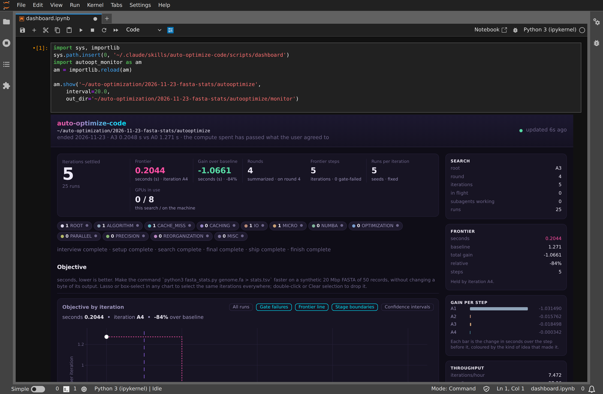
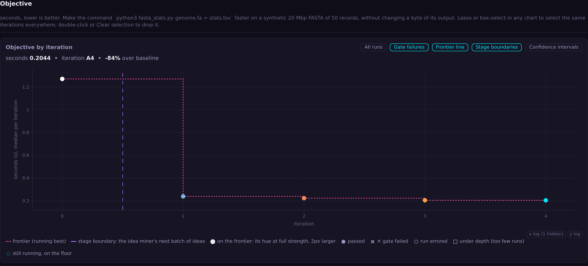

# A command-line tool, output byte-identical

`fasta_stats.py` prints one tab-separated line per FASTA record: its name,
length, GC fraction, N count and soft-masked count. It is correct and slow: a
Python loop tests every character with `islower()` and `upper()`. It needs only
the standard library.

```bash
python3 fasta_stats.py example.fa     # three records
```

This example shows a search on a whole command rather than a function: the
objective is the wall time of `python3 fasta_stats.py genome.fa > stats.tsv`,
interpreter start-up included, and the gate compares the output file byte for
byte.

## The prompt

From this folder, in Claude Code:

> Use auto-optimize-code to make fasta_stats.py faster. Time the whole
> command, `python3 fasta_stats.py genome.fa > stats.tsv`, on a synthetic
> 20 Mbp FASTA of 50 records with soft-masked stretches and runs of N. The
> output must stay byte-for-byte identical. Standard library only. Give it a
> budget of 4 iterations with sonnet subagents.

The interview's other answers were the recommended ones: 5 runs per
iteration, one thread, and three inputs observed but not gated: one record of
1 bp, 100,000 records of 100 bp, and one 20 Mbp record on a single line.

## The dashboard at the end





## What it found

The median went from 1.271 s (A0) to 0.2048 s (A3), 83.9% less. Paired
against A0 in alternating separate processes, A3 was faster in 9 of 9 pairs
(p = 0.0039). Every run of every iteration matched A0's output byte for byte.

- **A1**, kept, 0.239 s: the per-character loop became `str.count` calls and
  one `bytes.translate` that deletes the lowercase letters to count them.
- **A2**, kept, 0.2233 s: the file is read once as bytes and every count is
  taken over each record's byte range, with no per-line loop or string
  concatenation.
- **A3**, kept, 0.2048 s: one `translate` of the whole buffer through a
  256-byte class table, then eight range counts per record.
- **A4**, not kept, 0.2044 s: counting in 64 KiB blocks. Its median was
  inside the noise band (0.0058 s) of A3's, so the keep rule did not take it.
  The dashboard's frontier names A4, the best median measured; the winner is
  A3.

The observers moved with the objective: 100,000 short records went from
0.764 s to 0.223 s and the single-line record from 1.295 s to 0.199 s. The
1 bp input (0.039 s, mostly interpreter start-up) and peak memory (about
70 MB) did not move beyond their noise. One idea, writing the output with a
single `sys.stdout.write`, was left untried when the budget ran out.

## What it took

20 minutes from the start of setup to the end, 25 benchmark runs, and about
4.3 million weighted tokens over every agent session (`autoopt.py tokens`).
