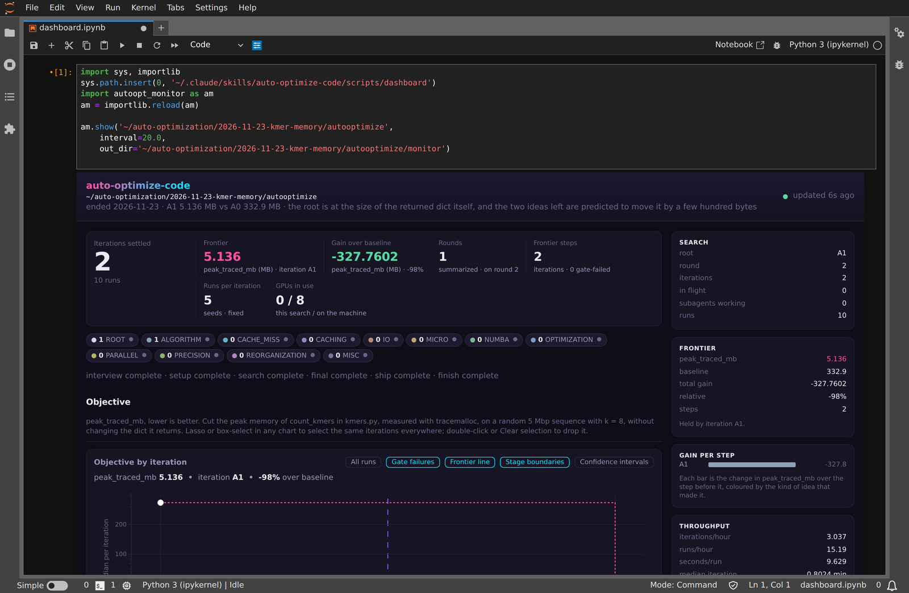
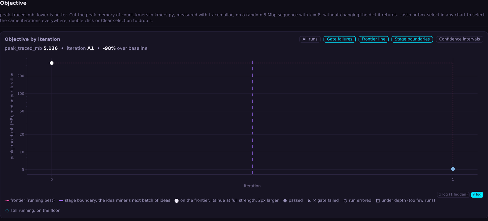

# Peak memory as the objective, time observed

`kmers.py` holds `count_kmers(sequence, k)`, which returns a dict of every
k-mer in a DNA sequence and its count, skipping windows that hold anything but
A, C, G or T. It is correct and wasteful: it builds a list of every window,
then a filtered copy, before counting. It needs only the standard library.

```bash
python3 kmers.py      # counts the 3-mers of a short sequence
```

This example shows an objective that is not time: the peak memory
`tracemalloc` sees during one call, with the time per call recorded beside it
as an observer, never optimized.

## The prompt

From this folder, in Claude Code:

> Use auto-optimize-code to cut the peak memory of count_kmers in kmers.py,
> measured with tracemalloc, on a random 5 Mbp sequence with k = 8. The
> returned dict must equal the original's: the same k-mers and counts, in any
> order. Record the time per call too, but do not optimize it. Standard
> library and numpy only. Budget: 4 iterations, sonnet subagents.

The interview's other answers were the recommended ones, with three inputs
observed but not gated: a sequence of exactly 8 bases, 1 Mbp that is about 30%
N, and 1 Mbp counted with k = 12.

## The dashboard at the end





## What it found

The peak went from 332.9 MB (A0) to 5.136 MB (A1), 98.5% less, in the first
iteration. A1 counts into one plain dict in a single pass over the runs of
A, C, G and T, so no list of windows is ever built. The returned dict matched
A0's on every run.

5.136 MB is about the size of the returned dict itself, which no change can
shrink. The orchestrator handed back at that point (a tenfold move in the
objective ends a phase), the two ideas left were predicted to move the peak by
a few hundred bytes, and the search was ended there.

The observers show what the change did elsewhere. The time per call fell from
1.12 s to 0.46 s; the paired timing at the end, which compares time and not
memory, has A1 faster in 9 of 9 pairs. The N-rich input's peak fell from
63.4 MB to 5.1 MB and the k = 12 input's from 123 MB to 83 MB. The 8-base
input's peak rose from 0.0006 MB to 0.0018 MB, the one cost.

Two things to know before trusting such a result. A peak traced by
`tracemalloc` is deterministic, so every run gives the same number, the noise
band is 0, and any decrease passes the keep rule; `keep.min_gain_pct` sets a
least gain when that is too loose. And the benchmark imports the module before
tracing starts, so memory allocated at import time is not counted: a change
that moved work to import time would look like a gain. The idea miner
flagged this; A1's only object made at import time is one compiled regular
expression.

## What it took

18 minutes from the start of setup to the end, 10 benchmark runs, and about
4.1 million weighted tokens over every agent session (`autoopt.py tokens`).
