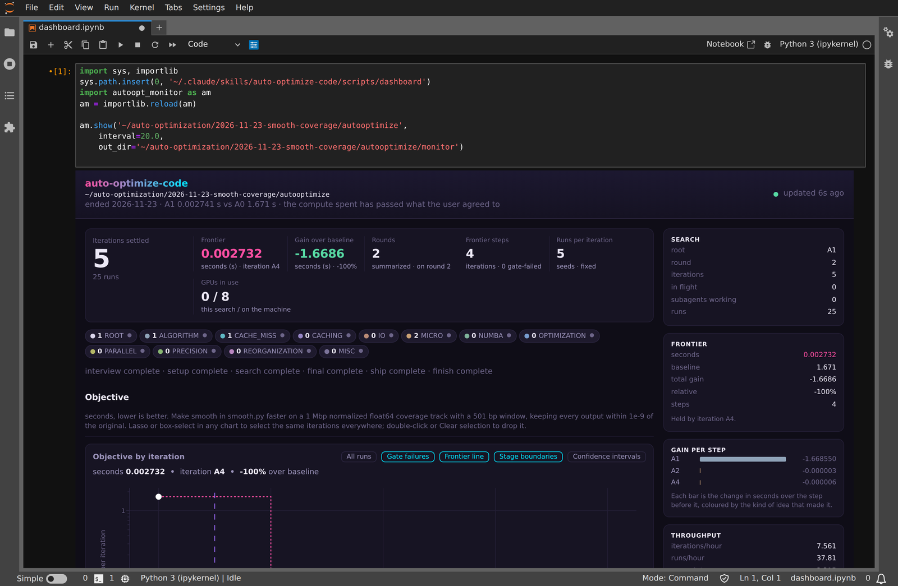
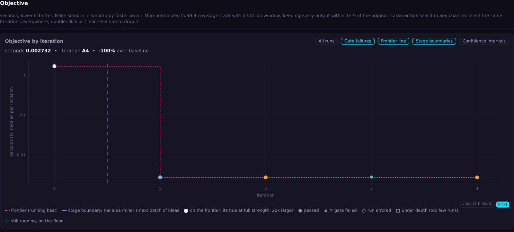

# A numeric tolerance as the gate

`smooth.py` holds `smooth(coverage, window)`, a centered moving average of a
coverage track, the window clipped at the ends. It is correct and slow: it
takes the mean of a slice at every position. It needs numpy.

```bash
python3 smooth.py      # smooths a short track
```

This example shows a gate that is not bitwise. The fast way to compute a
moving average, prefix sums, adds the values in a different order, so on a
track of non-integer values its outputs differ from the original's in the
last bits. A bitwise gate would refuse it; the gate here allows a difference
of at most 1e-9 at any position.

## The prompt

From this folder, in Claude Code:

> Use auto-optimize-code to make smooth in smooth.py faster on a 1 Mbp
> normalized (non-integer) float64 coverage track with a 501 bp window. The
> output may differ from the original's by at most 1e-9 at any position.
> numpy only, no new dependencies. Budget: 4 iterations, sonnet subagents.

The interview's other answers were the recommended ones, with three inputs
observed but not gated: a track of 1 value with a window of 1, 100 values with
a window of 501, and 3 Mbp.

Before measuring anything, the setup subagent checked the tolerance against
two kinds of change: a prefix-sum rewrite differed from the original by at
most 6.0e-12, and casting each window to float32 differed by 2.4e-7. The
threshold of 1e-9 sits between them, so it passes the first and fails the
second.

## The dashboard at the end





## What it found

The median went from 1.671 s (A0) to 0.002741 s (A1), 99.8% less, with a
worst difference of 6.8e-12 from the original's output. Paired against A0 in
alternating separate processes, A1 was faster in 9 of 9 pairs (p = 0.0039).

- **A1**, kept: prefix sums replace the per-position mean. The 600-fold drop
  ended the first phase, so the next phase measured the noise band again
  from A1's own runs.
- **A2**, not kept, 0.002738 s: writing into preallocated arrays, which A1
  already did. Inside the noise band.
- **A3**, not kept, 0.002792 s: working in blocks of 131,072 outputs. Slower
  on the benchmark, though it cut the 3 Mbp input's time by 12% and the peak
  memory from 15.3 MB to 8.6 MB.
- **A4**, not kept, 0.002732 s: returning a copy early when the window is 1.
  Inside the noise band on the benchmark, though it brought the 1-value input
  back to 0.3 µs.

The winner has costs the objective does not show, which the observers
recorded: the peak memory doubled, from 7.6 MB to 15.3 MB, and the 1-value
input went from 1.8 µs to 3.7 µs. The 3 Mbp input went from 5.2 s to 0.0099 s.

The timed call is now 2.7 ms, and a call that short, timed once per run, is
mostly clock noise. The orchestrator raised this at the end of the first
phase; a further search would repeat the call or use a larger track.

## What it took

24 minutes from the start of setup to the end, 25 benchmark runs, and about
4.5 million weighted tokens over every agent session (`autoopt.py tokens`).
